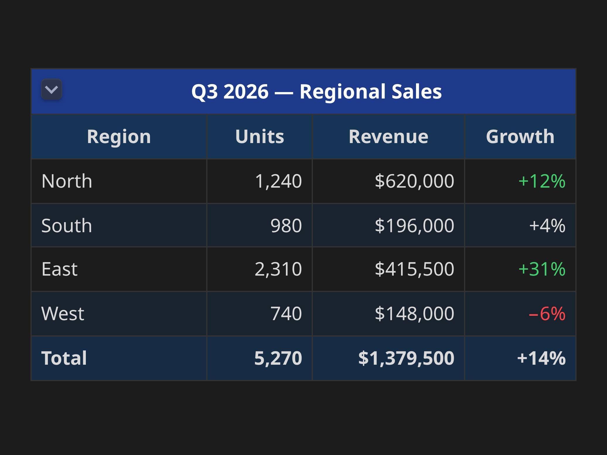
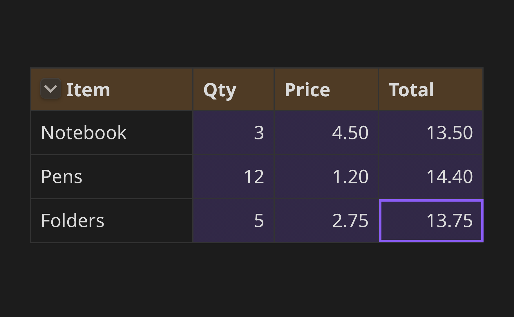
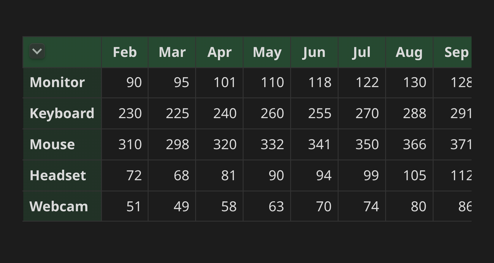
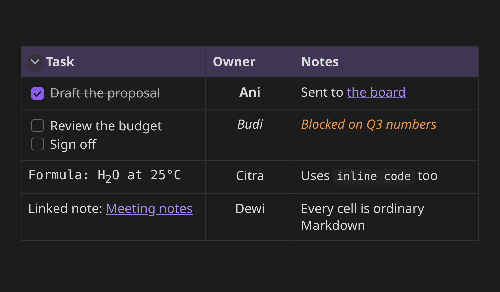

# Dream Table

Spreadsheet-style tables inside your Obsidian notes: merged cells, colors, frozen headers — and you edit them right where they sit.



Markdown tables are fine until you need a cell that spans two columns, a colored header, or a row that stays put while you scroll. Dream Table gives you those. You click a cell, type, and move on — there is no separate editor to open and no HTML to write.

## What you can do

- **Merge cells** across rows and columns.
- **Color** any cell's background and text, and pick from ready-made table looks.
- **Freeze** the top rows and the left columns so they stay in place while the rest scrolls.
- **Resize columns** by dragging the border between them.
- **Put anything in a cell** that you can write in a note: links, `[[wikilinks]]`, images, task checkboxes, bold and italic.
- **Copy and paste** whole blocks of cells, including to and from a spreadsheet.
- **Undo** with Ctrl+Z, like everywhere else.

## Getting started

1. In Obsidian, go to **Settings → Community plugins → Browse**, search for **Dream Table**, then install and enable it.
2. Open a note, press Ctrl/Cmd+P, and run **Dream Table: Insert table**. It asks how many rows and columns you want.
3. Click any cell and start typing.

Already have an ordinary Markdown table? Put your cursor in it and run **Dream Table: Convert Markdown table**, or right-click it and choose *Convert to Dream Table*. Your header row, column alignment and line breaks all come across.

## Editing

The cell you are in is always ready for typing — there is no separate "select" mode to switch into.

| Key | What it does |
| --- | --- |
| Click | Edit that cell |
| Tab / Shift+Tab | Next / previous cell |
| Arrow keys | Move through the text, then on to the next cell |
| Enter | New line inside the cell |
| Ctrl/Cmd+Enter | Save and start a new row |
| Escape | Undo your typing in this cell |
| Ctrl/Cmd+B / +I | Bold / italic |
| Ctrl/Cmd+K | Insert a link |
| Ctrl/Cmd+Z | Undo the last change to the table |

To work on several cells at once, drag across them or hold Shift and click. Hold Ctrl/Cmd to add more cells to the selection. Anything you then choose — a color, bold, a border — applies to all of them.



## Formatting

Right-click anywhere in the table for the full menu. In short:

- **Structure** — merge and unmerge cells, insert or delete rows and columns, clear what is in them.
- **Look** — background and text color, bold, italic, alignment, borders, padding, font and font size. You can set these for the selected cells, or for the whole table at once.
- **Ready-made styles** — *Table style…* colors a header row, a header column, or every second row in one click.
- **Header and freezing** — mark the top rows as a header, collapse the table down to it, or freeze rows and columns in place.
- **Images** — *Insert image…* picks one from your vault. You can also paste or drop an image straight onto a cell; it is saved as an attachment like any other.

## Frozen rows and columns

Set a few rows and columns to stay put, and a long or wide table scrolls inside its own box while the headers remain visible — like freeze panes in a spreadsheet.



## Every cell is ordinary Markdown

Tick a checkbox, follow a link, read a formula. Whatever you can write in a note, you can write in a cell.



## Your notes stay plain text

A Dream Table is stored in your note as a small block of readable text, so nothing is locked away in a database and your note still works without the plugin installed:

````markdown
```dreamtable
rows:
  - [Region, Units, Revenue]
  - [North, 1240, "$620,000"]
  - [South, 980, "$196,000"]
header: 1
styles:
  - { range: A1:C1, bold: true }
```
````

You never have to write this by hand — everything above is done through clicks and keystrokes. But if you ever want to edit a table as text, or you are curious what the options are, the [full reference](docs/reference.md) lists every setting.

## Good to know

- Tables work in both Live Preview and Reading view, and on mobile.
- A table shown inside an embedded note is read-only.
- If a table has a mistake in it, the plugin shows you a plain list of what is wrong instead of breaking your note.

## Help and contributing

Found a bug or have an idea? Please [open an issue](https://github.com/desdrianton/obsidian_my_dream_table/issues). If you want to work on the plugin itself, see [CONTRIBUTING.md](CONTRIBUTING.md).

## About

This plugin was written 100% by [Claude Code](https://claude.com/claude-code): all code, tests, and documentation.
